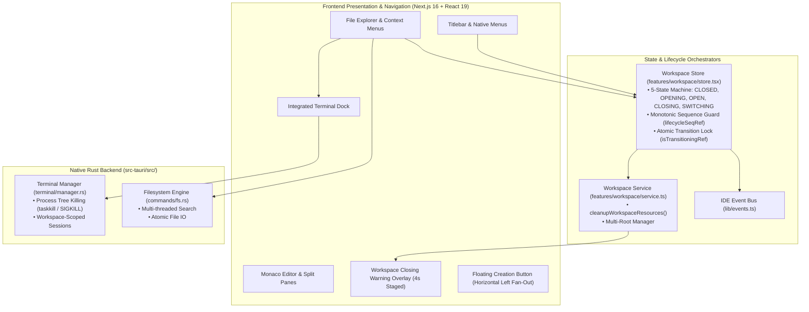

<div align="center">

# ⚡ Kairo IDE

**Next-Generation Desktop Code Editor Built with Next.js 16, React 19, Tauri v2 & Rust**

[](https://nextjs.org/)
[](https://react.dev/)
[](https://www.typescriptlang.org/)
[](https://v2.tauri.app/)
[](https://www.rust-lang.org/)
[](https://tailwindcss.com/)
[](https://vitest.dev/)
[](LICENSE)

<p align="center">
  A blazing-fast, secure, and extensible desktop code IDE combining the rapid iteration of modern React with the raw performance and low memory footprint of Rust.
</p>

[Key Features](#-key-features) •
[Architecture](#-architecture-overview) •
[Workspace Lifecycle](#-workspace-lifecycle-management) •
[Terminal & PTY](#-integrated-terminal--pty-architecture) •
[Security Hardening](#-security-hardening) •
[Supported Languages](#-supported-languages) •
[Themes](#-14-built-in-themes) •
[Shortcuts](#-keyboard-shortcuts) •
[Getting Started](#-getting-started) •
[Testing](#-testing--quality-assurance)

</div>

---

## 🌟 Overview

**Kairo IDE** is an enterprise-grade desktop code development environment engineered from the ground up for speed, safety, and productivity. Combining a lightweight **Next.js 16** and **React 19** frontend shell with a **Tauri v2** native backend written in **Rust**, Kairo provides instantaneous file operations, multi-threaded workspace indexing, native pseudo-terminal (PTY) virtualization, and a rich **Monaco Editor** coding experience—while consuming a fraction of the RAM required by traditional Electron-based editors.

---

## 🚀 Key Features

### 1. 🗂️ Workspace Lifecycle & Resource Teardown
- **Deterministic 5-State Lifecycle Machine**: Governed strictly by `CLOSED`, `OPENING`, `OPEN`, `CLOSING`, and `SWITCHING` lifecycle states.
- **Race Condition & Concurrency Guards**: Monotonic sequence tracking (`lifecycleSeqRef`) and transition locks (`isTransitioningRef`) ensure rapid switching between workspaces always executes sequentially without state collisions or orphaned processes.
- **VS Code-Style 4-Second Closing Warning Overlay**: Displays a sleek backdrop-blurred closing overlay reporting live progress across 4 stages (Terminals, Editor models, Filesystem watchers, and Workspace resources) with synchronized animated progress bars.
- **Unsaved Changes Safety Shield**: Proactive dirty document check before closing or switching workspaces with *Save All*, *Don't Save*, and *Cancel* options.
- **Multi-Root Workspace Architecture**: Support for multi-root workspaces allowing developers to add and manage multiple project folders simultaneously in a single IDE window.
- **Native OS Folder Picker**: Seamlessly open folders via native file system dialogs (`rfd` crate).
- **Persistent Recent Workspaces**: Automatic deduplication, MRU ordering, configurable storage capacity, and clean state restoration.

### 2. 💻 Integrated Pseudo-Terminal (PTY) Subsystem
- **Native Rust PTY Engine**: Built on `portable-pty` for asynchronous, low-latency terminal emulation.
- **"Open in Integrated Terminal" Folder Navigation**: Right-click any directory in the file explorer (or the workspace root) to spawn or activate a terminal initialized strictly in that folder across Windows, Linux, and macOS.
- **Cross-Platform Process Tree Termination**:
  - **Windows**: Executes forceful tree termination (`taskkill /pid <PID> /T /F`) to kill root shells and all spawned child processes (Node.js, Vite, Cargo, etc.).
  - **Unix / macOS**: Dispatches `SIGTERM` followed by a grace period and `SIGKILL` to ensure zero orphaned background processes.
- **Optional Workspace Terminal Persistence**: Configurable `terminal.persistAcrossWorkspaces` setting allowing background jobs to persist across workspace switches.
- **Multi-Session & Split Terminals**: Support for multiple concurrent shell tabs, horizontal/vertical splits, custom shell profiles (PowerShell, Bash, Zsh, CMD), search, and themes.

### 3. 🌲 Real Filesystem Explorer & Floating Creation Action
- **Direct OS Binding**: Zero mock data—all reads and writes execute against the real filesystem via sandboxed Tauri IPC.
- **Lazy-Loaded Tree Traversal**: Directories load on demand, maintaining silky smooth 60 FPS scrolling even on 100,000+ file codebases.
- **Horizontal Floating Creation Menu**: A circular action button fixed to the IDE viewport that expands horizontally to the left into "New File" and "New Folder" circular options with top-floating tooltips and a destination tree picker.
- **Full File & Directory Operations**:
  - Create file and folder with strict validation (protecting against illegal characters and Windows reserved device names: `CON`, `PRN`, `AUX`, `NUL`, `COM1-9`, `LPT1-9`).
  - Inline rename (`F2`) with path collision pre-checks.
  - Delete with safety confirmation modal to prevent accidental loss.
  - Clipboard operations: Recursive copy, cut, and paste with ancestor/descendant circular recursion safeguards.
  - Duplicate file with smart collision numbering (`file copy.ts`, `file copy 2.ts`).
  - Drag-and-drop moving of files and folders across tree branches.
- **Seti & Lucide Icon Themes**: File-type-specific icon resolution for 60+ extensions and well-known configuration manifests.

### 4. 📝 Advanced Code Editor (Monaco)
- **Monaco Engine (`^0.58.0`)**: Bundled offline (`loader.config({ monaco })`) with zero CDN dependency.
- **Multi-Tab Document Management**:
  - Responsive horizontal tab strip with middle-click close, pin indicators, and Seti file icons.
  - Context menu options: *Close*, *Close Others*, *Close All*, *Copy Path*, *Copy Relative Path*, and *Reveal in OS Explorer*.
- **Multi-Split Editor Panels**: Split editor groups horizontally and vertically with independent model instances and synchronous viewState tracking.
- **Complete Model Disposal on Workspace Close**: Deterministic disposal of all Monaco models (`ModelService.disposeAll()`) preventing memory leaks on workspace transitions.
- **Document Dirty Tracking & Safety**:
  - Real-time dirty state bullet (`•`) indicating unsaved changes.
  - Single-file save (`Ctrl+S` / `Cmd+S`) and batch Save All (`Ctrl+Alt+S`).
  - External modification detection alerting users to disk changes.
- **Binary & Large File Safeguards**:
  - Fast null-byte heuristic inspection and 20MB file threshold.
  - Native image preview for `.png`, `.jpg`, `.jpeg`, `.svg`, `.webp`, `.gif`, and `.ico`.
  - Binary alert banner with direct button to reveal the file in the OS explorer.
- **Breadcrumb Navigation & Status Bar**:
  - Interactive workspace-relative folder and file path breadcrumbs.
  - Comprehensive status bar showing line & column, space indentation, UTF-8 encoding, language mode, and quick Format Document button.

### 5. 🔍 High-Performance Workspace Search & Replace
- **Multi-Threaded Rust Engine**: Powered by Rust's `regex` crate for rapid disk searching across large codebases.
- **Flexible Search Query Options**:
  - Case Sensitivity toggle (`Alt+C`).
  - Whole Word matching toggle (`Alt+W`).
  - Regular Expression support (`Alt+R`).
  - Include & Exclude glob patterns (e.g. `src/**, *.tsx`, `!node_modules, !dist`).
- **Interactive Results Tree**: Grouped by file with hit counters, line/column markers, and highlighted code snippets. Clicking jumps directly to the matching line.
- **Safe Workspace Replace**:
  - Batch replacement modal with total affected file and match count preview before disk commits.
  - Bottom-to-top replacement algorithm ensuring line and offset integrity during multi-match writes.

### 6. ⚡ Command Palette & Keybinding Registry
- **Command Palette (`Ctrl+Shift+P` / `Cmd+Shift+P`)**:
  - Quick fuzzy search across all application, editor, file, and workspace commands.
  - Categorized command groupings (File, Edit, View, Workspace, Theme, Help).
- **Quick Open (`Ctrl+P` / `Cmd+P`)**: Instant fuzzy file finder scanning the entire workspace.
- **Go to Line (`Ctrl+G` / `Cmd+G`)**: Direct line and column jumping (`line[:col]`) with boundary validation.
- **Centralized Keybinding Registry**: Dispatch engine for customizable global and scoped keyboard shortcuts.

### 7. 🎨 14 Built-In Professional Themes
Instant theme switching with synchronized Monaco token colors and Tailwind design tokens:
- **Dark+** (Default VS Code Dark)
- **Light+** (Default VS Code Light)
- **Monokai**
- **Nord**
- **Dracula**
- **SynthWave '84**
- **One Dark Pro**
- **GitHub Dark**
- **Tokyo Night**
- **Solarized Dark**
- **Cyberpunk**
- **Catppuccin Mocha**
- **Moonlight**
- **Retro 80s**

---

## 🏗 Architecture Overview



---

## 🛡️ Security Hardening

Kairo IDE incorporates comprehensive defense-in-depth security measures across both the frontend webview and the native Rust backend:

| Threat Vector | Mitigation Strategy | Location |
| :--- | :--- | :--- |
| **Command Injection in `fs_reveal`** | Strict validation rejecting double quotes (`"`) before passing raw arguments to Windows `explorer.exe /select,`. | [`src-tauri/src/commands/fs.rs`](file:///c:/Users/Aatharva%20Gurav/Desktop/work/kairo-ide/src-tauri/src/commands/fs.rs) |
| **Orphaned Process Exploitation** | Full process tree termination (`taskkill /T /F` on Windows; process group `SIGKILL` on Unix) preventing orphaned long-running processes on workspace close. | [`src-tauri/src/terminal/session.rs`](file:///c:/Users/Aatharva%20Gurav/Desktop/work/kairo-ide/src-tauri/src/terminal/session.rs) |
| **Rust Multi-Byte UTF-8 Slicing Panic** | Non-ASCII searches advance char byte lengths (`c.len_utf8()`) rather than raw byte counts. Line slices validate `.is_char_boundary()`. | [`src-tauri/src/commands/fs.rs`](file:///c:/Users/Aatharva%20Gurav/Desktop/work/kairo-ide/src-tauri/src/commands/fs.rs) |
| **Directory Traversal (`..`)** | Path normalization resolves and collapses `.` and `..` segments for both Windows drives and POSIX paths before boundary checks. | [`lib/tauri-ipc.ts`](file:///c:/Users/Aatharva%20Gurav/Desktop/work/kairo-ide/lib/tauri-ipc.ts) |
| **Circular Symlink & Junction DoS** | Recursive workspace traversals enforce a strict 32-level depth limit to prevent stack overflows and memory exhaustion. | [`src-tauri/src/commands/fs.rs`](file:///c:/Users/Aatharva%20Gurav/Desktop/work/kairo-ide/src-tauri/src/commands/fs.rs) |
| **Content Security Policy (CSP)** | Enforces strict CSP with `worker-src 'self' blob:;` for Monaco workers and `connect-src 'self' ipc: https: wss:;` for Supabase auth. | [`src-tauri/tauri.conf.json`](file:///c:/Users/Aatharva%20Gurav/Desktop/work/kairo-ide/src-tauri/tauri.conf.json) |
| **Windows Reserved Filenames** | Blocks creation or renaming of device-reserved names (`CON`, `PRN`, `AUX`, `NUL`, `COM1-9`, `LPT1-9`). | [`features/editor/components/floating-creation/validation.ts`](file:///c:/Users/Aatharva%20Gurav/Desktop/work/kairo-ide/features/editor/components/floating-creation/validation.ts) |

---

## 🌐 Supported Languages

Kairo IDE includes full detection, syntax coloring, and Monaco editor mappings for **over 50 programming languages**:

- **Web Technologies**: TypeScript, JavaScript, JSX, TSX, HTML, CSS, SCSS, LESS, JSON, JSONC, GraphQL, WebAssembly
- **Systems Languages**: Rust, C, C++, C#, Go, Zig, Swift, Objective-C
- **Backend & Scripting**: Python, Ruby, PHP, Java, Kotlin, Scala, Dart, Perl, R, Lua, Julia, Elixir, Erlang, Haskell, Clojure, Groovy
- **Config & Infrastructure**: Bash, Zsh, PowerShell, Batch, YAML, TOML, XML, INI, Dockerfile, Makefile, SQL, Prisma
- **Documentation**: Markdown, LaTeX, Plain Text

---

## ⌨️ Keyboard Shortcuts

| Shortcut (Windows/Linux) | Shortcut (macOS) | Action | Scope |
| :--- | :--- | :--- | :--- |
| <kbd>Ctrl</kbd> + <kbd>Shift</kbd> + <kbd>P</kbd> | <kbd>Cmd</kbd> + <kbd>Shift</kbd> + <kbd>P</kbd> | Open Command Palette | Global |
| <kbd>Ctrl</kbd> + <kbd>P</kbd> | <kbd>Cmd</kbd> + <kbd>P</kbd> | Quick Open File | Global |
| <kbd>Ctrl</kbd> + <kbd>Shift</kbd> + <kbd>F</kbd> | <kbd>Cmd</kbd> + <kbd>Shift</kbd> + <kbd>F</kbd> | Search in Workspace | Global |
| <kbd>Ctrl</kbd> + <kbd>K</kbd> <kbd>F</kbd> | <kbd>Cmd</kbd> + <kbd>K</kbd> <kbd>F</kbd> | Close Current Workspace | Global |
| <kbd>Ctrl</kbd> + <kbd>B</kbd> | <kbd>Cmd</kbd> + <kbd>B</kbd> | Toggle Sidebar | Global |
| <kbd>Ctrl</kbd> + <kbd>\`</kbd> | <kbd>Cmd</kbd> + <kbd>\`</kbd> | Toggle Integrated Terminal Panel | Global |
| <kbd>Ctrl</kbd> + <kbd>S</kbd> | <kbd>Cmd</kbd> + <kbd>S</kbd> | Save Active Document | Editor |
| <kbd>Ctrl</kbd> + <kbd>Alt</kbd> + <kbd>S</kbd> | <kbd>Cmd</kbd> + <kbd>Alt</kbd> + <kbd>S</kbd> | Save All Open Documents | Editor |
| <kbd>Ctrl</kbd> + <kbd>W</kbd> | <kbd>Cmd</kbd> + <kbd>W</kbd> | Close Active Tab | Editor |
| <kbd>Shift</kbd> + <kbd>Alt</kbd> + <kbd>F</kbd> | <kbd>Shift</kbd> + <kbd>Option</kbd> + <kbd>F</kbd> | Format Document | Editor |
| <kbd>Ctrl</kbd> + <kbd>G</kbd> | <kbd>Cmd</kbd> + <kbd>G</kbd> | Go to Line / Column | Editor |
| <kbd>F12</kbd> | <kbd>F12</kbd> | Go to Definition | Editor |
| <kbd>Alt</kbd> + <kbd>F12</kbd> | <kbd>Option</kbd> + <kbd>F12</kbd> | Peek Definition | Editor |
| <kbd>Shift</kbd> + <kbd>F12</kbd> | <kbd>Shift</kbd> + <kbd>F12</kbd> | Find All References | Editor |
| <kbd>Ctrl</kbd> + <kbd>F</kbd> | <kbd>Cmd</kbd> + <kbd>F</kbd> | In-File Find | Editor |
| <kbd>Ctrl</kbd> + <kbd>H</kbd> | <kbd>Cmd</kbd> + <kbd>H</kbd> | In-File Replace | Editor |
| <kbd>F2</kbd> | <kbd>Enter</kbd> | Rename File or Folder | File Explorer |
| <kbd>Delete</kbd> | <kbd>Cmd</kbd> + <kbd>Backspace</kbd> | Delete File or Folder | File Explorer |

---

## 📦 Project Structure

```text
kairo-ide/
├── app/                               # Next.js 16 App Router
│   ├── layout.tsx                     # Root HTML shell & Theme Providers
│   ├── page.tsx                       # Master IDE Shell & Overlay Orchestrator
│   └── auth/                          # Supabase Auth routing
├── components/                        # Common UI and Shell Components
│   ├── app-sidebar.tsx                # Activity bar and collapsible sidebar
│   ├── app-titlebar.tsx               # Window titlebar, menus, and workspace status
│   └── ui/                            # Atomic shadcn/ui components
├── features/                          # Domain-Driven Feature Modules
│   ├── auth/                          # Supabase auth services and modals
│   ├── commands/                      # Command Palette, fuzzy search, keybindings
│   ├── editor/                        # Monaco Editor, split views, formatters, intellisense
│   │   └── components/floating-creation/ # Viewport-anchored horizontal creation FAB
│   ├── file-explorer/                 # Real OS file tree, drag-and-drop, context menus
│   ├── icon-theme/                    # Seti & Lucide icon resolution
│   ├── search/                        # Multi-threaded workspace search & replace
│   ├── settings/                      # Preferences, theme customization, shortcuts
│   ├── terminal/                      # Embedded terminal emulator tabs & PTY bridge
│   ├── theme/                         # 14 color themes & CSS variable token engine
│   └── workspace/                     # 5-State lifecycle, closing overlay, multi-root
├── lib/                               # Cross-cutting libraries
│   ├── events.ts                      # Typed IDE event bus
│   ├── tauri-ipc.ts                   # Sandboxed Tauri IPC invoker & path utilities
│   └── watcher.ts                     # Real-time native filesystem watcher
├── src-tauri/                         # Rust Native Backend
│   ├── Cargo.toml                     # Cargo dependencies & release profiles
│   ├── tauri.conf.json                # Tauri v2 capabilities, permissions, CSP
│   └── src/
│       ├── lib.rs                     # Tauri builder and command registration
│       ├── main.rs                    # Desktop binary entrypoint
│       ├── menu.rs                    # Native OS application menus
│       ├── commands/                  # Native filesystem and workspace commands
│       └── terminal/                  # PTY process manager, tree kill, and shell detector
└── vitest.config.ts                   # Unit & integration test configuration
```

---

## 🛠️ Getting Started

### Prerequisites

Ensure you have the following installed on your machine:
- **Node.js**: `v20.x` or higher ([Download](https://nodejs.org/))
- **npm** or **pnpm**
- **Rust Toolchain**: `1.77.2` or higher ([Install via rustup](https://rustup.rs/))
- **Platform Dependencies**:
  - **Windows**: [WebView2 Runtime](https://developer.microsoft.com/en-us/microsoft-edge/webview2/) and [C++ Build Tools](https://visualstudio.microsoft.com/visual-cpp-build-tools/).
  - **Linux**: `libwebkit2gtk-4.1-dev`, `build-essential`, `curl`, `wget`, `file`, `libssl-dev`, `libgtk-3-dev`, `libayatana-appindicator3-dev`, `librsvg2-dev`.
  - **macOS**: Xcode Command Line Tools.

### Installation

1. **Clone the repository**:
   ```bash
   git clone https://github.com/your-username/kairo-ide.git
   cd kairo-ide
   ```

2. **Install frontend dependencies**:
   ```bash
   npm install
   ```

### Running in Development

- **Web Browser Preview**:
   ```bash
   npm run dev
   ```
   *Opens the IDE shell in web fallback mode at `http://localhost:3000`.*

- **Full Native Desktop Application**:
   ```bash
   npx tauri dev
   ```
   *Compiles the native Rust backend, launches Tauri v2, and attaches the hot-reloading Next.js dev server.*

---

## 🧪 Testing & Quality Assurance

Kairo IDE maintains strict continuous quality standards across both frontend and backend layers:

```bash
# 1. Run TypeScript static type check (0 errors)
npx tsc --noEmit

# 2. Run ESLint code quality analysis (0 errors)
npm run lint

# 3. Run full Vitest frontend suite (24 test files, 225 tests passed)
npm run test

# 4. Check Rust compiler
cargo check --manifest-path src-tauri/Cargo.toml

# 5. Run Rust backend unit test suite (23 tests passed)
cargo test --manifest-path src-tauri/Cargo.toml

# 6. Run strict Rust Clippy linter (0 warnings)
cargo clippy --manifest-path src-tauri/Cargo.toml
```

---

## 📄 License

This project is licensed under the **MIT License** — see the [LICENSE](LICENSE) file for details.
