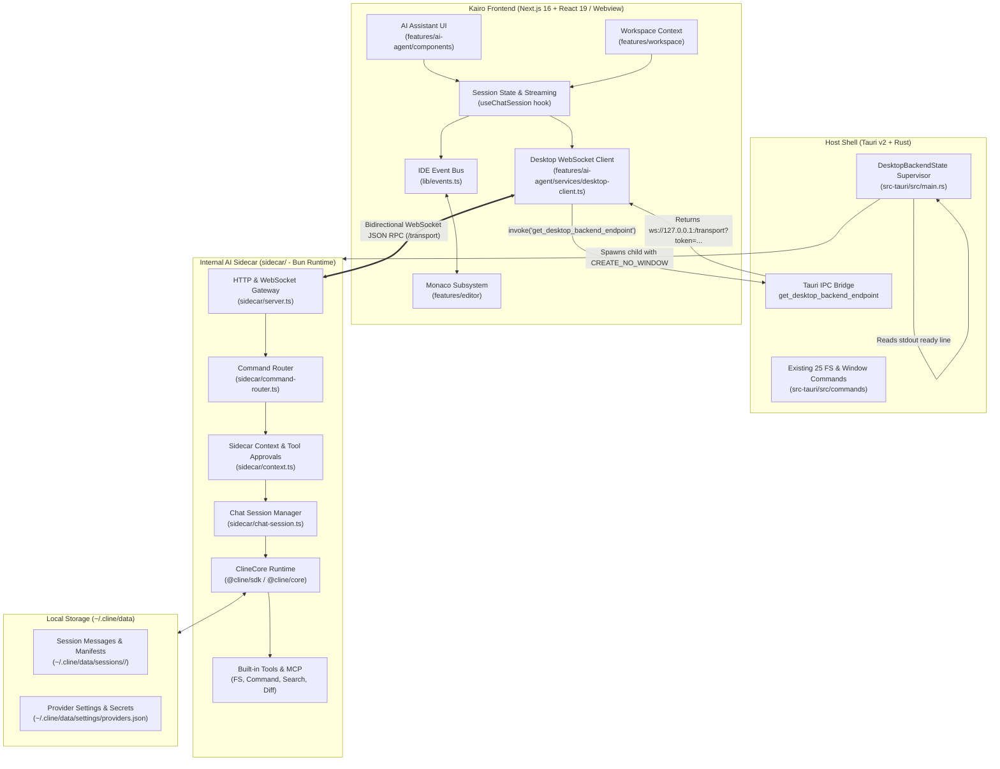
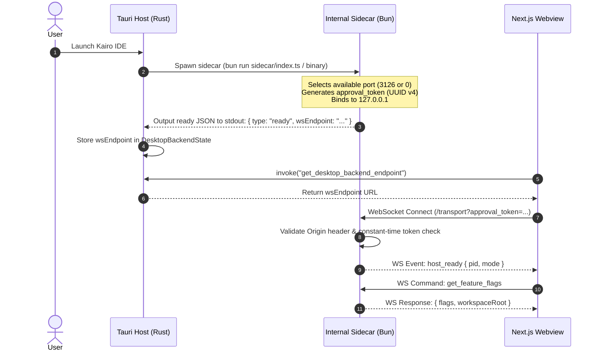
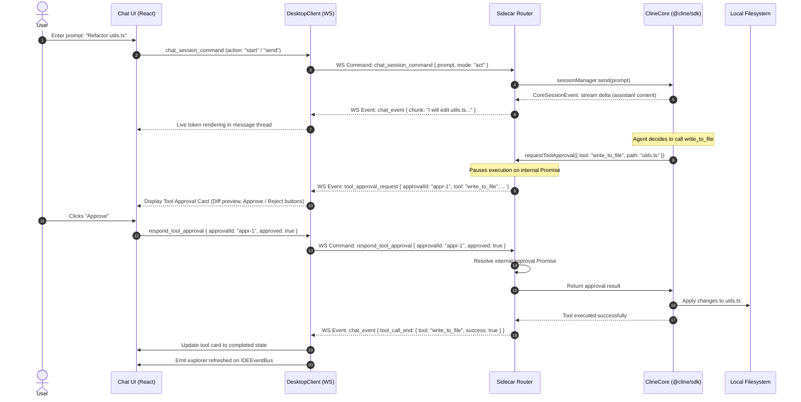

# 06 — Kairo AI Agent Target Architecture

## 1. Architectural Overview

The Kairo AI coding-agent subsystem is designed as an internal, process-isolated companion service embedded directly into the Kairo IDE desktop application.

It unites three distinct tiers into a single cohesive desktop IDE:
1. **Frontend Presentation Shell (Next.js 16 + React 19)**: The existing static-export webview providing editor panes, workspace trees, command palettes, and the newly integrated AI Assistant interface.
2. **Internal Agent Companion (Bun TypeScript Sidecar)**: A lightweight, headless process residing in the internal `sidecar/` directory that initializes and hosts `ClineCore` (`@cline/sdk`), manages agent execution turns, handles tool permissions, and communicates via a loopback WebSocket.
3. **Native Host & Supervisor (Tauri v2 + Rust)**: The native desktop wrapper supervising the lifecycle of the sidecar process, mediating OS window events, handling native dialogs, and securely passing endpoints to the webview.

---

## 2. Architecture Diagram

---

## 3. End-to-End Operational Lifecycle

### 3.1 Startup & Handshake Sequence

### 3.2 Turn Execution and Tool Approval Sequence

---

## 4. Key Architectural Decisions

1. **Process Isolation Over Shared Heap**:
   - The AI agent runtime runs in its own OS process, decoupled from the Next.js frontend webview.
   - Any crash, CPU spike, or memory leak in AI streaming or complex AST indexing cannot crash the editor or freeze Monaco typing.
2. **Standard Loopback WebSocket Bridge**:
   - Matches the official Cline desktop architecture (`/transport`).
   - Enables bi-directional, full-duplex communication without polling.
   - Single port allocation with dynamic fallback (`0`) prevents port collision errors.
3. **No Monorepo Leaks**:
   - The sidecar relies entirely on published, standard semantic-version packages from npm (`@cline/sdk@^0.2.0`).
   - No `workspace:*` dependencies.
4. **Next.js Static Export Protection**:
   - Node-only native binaries (`@cline/core`, `ws`, `nanoid`, `simple-git`) reside solely within the `sidecar/` execution tree.
   - The Next.js frontend maintains its pristine `output: "export"` static compatibility.
5. **Zero Disruption to Existing Kairo Features**:
   - Existing 25 Rust commands, Monaco model caching, 14 color themes, and offline guest authentication remain 100% untouched.
