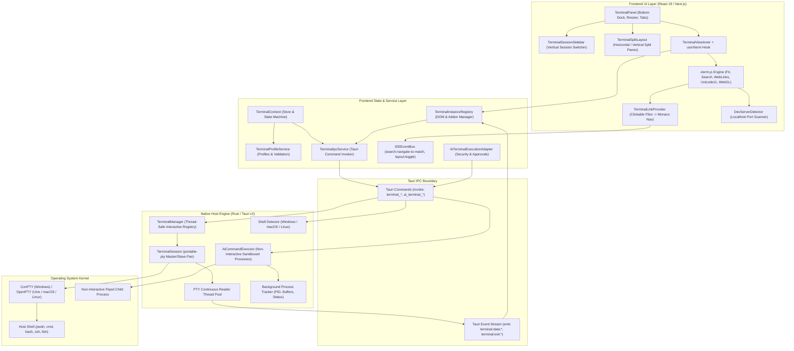
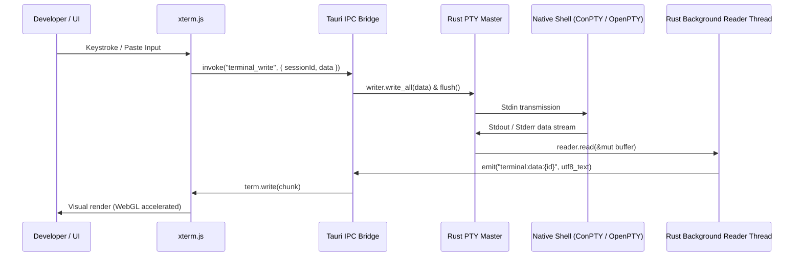
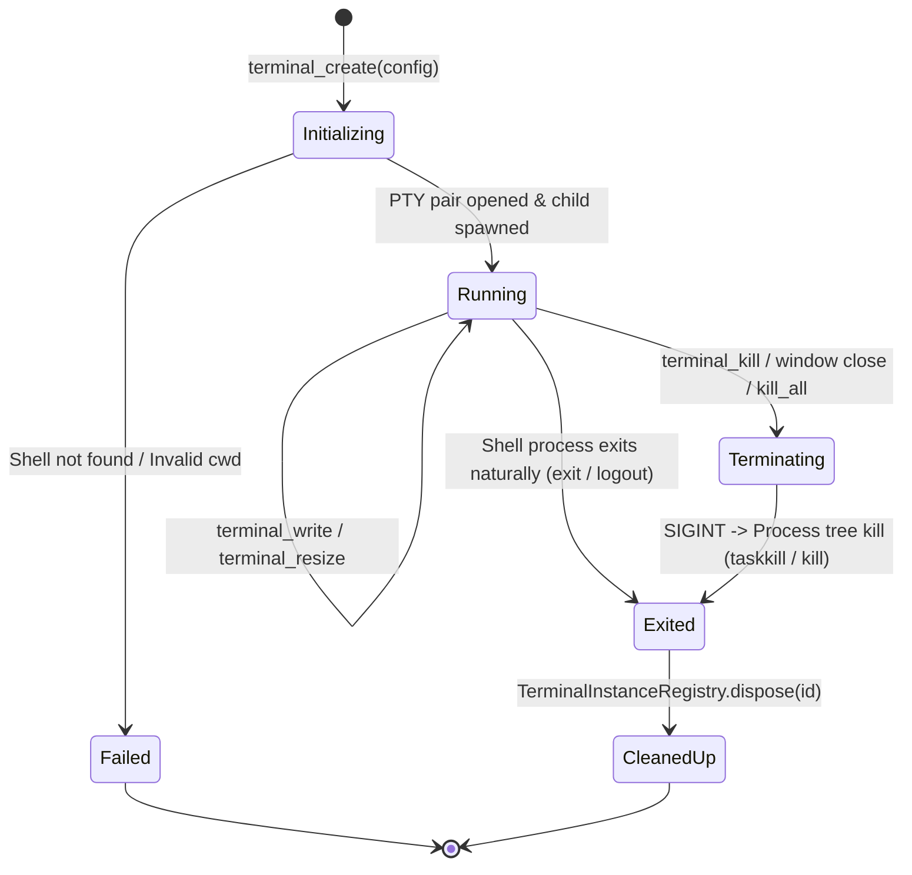

# Kairo IDE – Terminal Subsystem Architecture

## 1. System Overview

The Kairo IDE Integrated Terminal provides a high-performance, developer-grade terminal emulator natively integrated into the Kairo desktop application. It combines:
- **Frontend Presentation Layer**: Built with `@xterm/xterm` (v5+), WebGL acceleration, and modern React 19 UI components styled to match Kairo's dark/light design system.
- **IPC & Transport Layer**: Asynchronous Tauri v2 inter-process communication using streaming event channels (`terminal:data:{id}`, `terminal:exit:{id}`).
- **Native Host Backend (Rust)**: PTY allocation via `portable-pty`, thread-safe session concurrency via `Arc<Mutex<...>>` and `RwLock`, and cross-platform process tree lifecycle management.
- **Controlled AI Execution Sandbox**: Completely decoupled execution runner (`AiCommandExecutor`) providing non-interactive child process execution with default-deny user approval gates, output bounding, and credential redaction for future AI coding agent integrations.

---

## 2. High-Level Architecture Diagram

---

## 3. Structural Layer Separation

### 3.1 Presentation Layer (`features/terminal/components/`)
- **`terminal-panel.tsx`**: Host container residing at the bottom of the Kairo workspace. Maintains persistent height in `localStorage`, supports minimize, maximize, and smooth drag-resizing.
- **`terminal-panel-header.tsx`**: Header bar displaying panel title, session counter, search toggle, split action buttons, shell profile switcher, maximize toggle, and close control.
- **`terminal-session-sidebar.tsx`**: Vertical session switcher inspired by modern developer IDEs. Automatically appears when multiple sessions exist (`sessions.length > 1`) and hides on single-session configurations to preserve horizontal real estate.
- **`terminal-split-layout.tsx`**: Dynamic split-pane container supporting horizontal and vertical pane division with synchronized drag-resizing.
- **`terminal-view-inner.tsx`**: Container element mounting the underlying `xterm.js` canvas/DOM element. Attaches a debounced `ResizeObserver` to trigger fit calculations.
- **`terminal-find-widget.tsx`**: Non-intrusive floating search widget supporting next/previous match navigation, case-sensitivity toggles, and instant visual highlighting.

### 3.2 State & Registry Management (`features/terminal/services/`)
- **`terminal-instance-registry.ts`**: Static registry maintaining active `TerminalInstance` records (including `Terminal`, `FitAddon`, `SearchAddon`, `WebLinksAddon`, `Unicode11Addon`, and `WebglAddon`). Decouples high-volume terminal output from React render cycles: output chunks stream directly into xterm via listeners, entirely bypassing React reconciliation.
- **`terminal-profile.service.ts`**: Pure service that manages user-defined custom profiles, validates shell executables and arguments, and merges system-discovered shells with user overrides.
- **`terminal-theme.service.ts`**: Translates Kairo IDE theme tokens (from all 14 built-in light and dark themes) into xterm-compatible color palettes (`ITheme`).
- **`terminal-link-provider.ts`**: Regex-based link provider scanning buffer lines for file paths with optional line and column specifiers (`file.ts:42:10`). Clicks dispatch `search:navigate-to-match` across `IDEEventBus` to activate Monaco editor tabs.
- **`dev-server-detector.ts`**: Output inspector detecting `localhost` and `127.0.0.1` development server URLs, notifying subscribers to surface browser launcher actions.

### 3.3 Native Rust Backend (`src-tauri/src/terminal/`)
- **`manager.rs` (`TerminalManager`)**: Thread-safe registry (`Arc<RwLock<HashMap<String, Arc<TerminalSession>>>>`) orchestrating active PTY sessions, workspace root directory propagation, and bulk teardown.
- **`session.rs` (`TerminalSession`)**: Manages individual PTY master/slave pairs via `portable-pty`. Spawns a dedicated OS thread per session to continuously read from the master PTY and emit data events to the frontend. Implements graceful two-stage termination (Ctrl+C interrupt signal followed by process tree termination).
- **`shells.rs`**: Cross-platform shell discovery detecting PowerShell 7, Windows PowerShell, CMD, Git Bash, and WSL on Windows; zsh, bash, and Homebrew shells on macOS; and bash, zsh, fish, and sh on Linux. Includes system `PATH` resolution in `validate_executable`.
- **`ai_executor.rs` (`AiCommandExecutor`)**: Dedicated non-interactive command execution engine executing piped child processes with timeout enforcement, output byte bounds (1 MB default), cancellation tokens, and full process tree cleanup (`stop_all`). Completely isolated from interactive PTY sessions.

---

## 4. Concurrency Model & Data Flow

### 4.1 Thread Allocation
1. **Main UI Thread**: Handles React UI rendering, event dispatching, and xterm layout calculations.
2. **Tauri IPC Worker Pool**: Handles incoming Tauri command invocations asynchronously without blocking the UI.
3. **Dedicated Reader Thread per Session**: Each active `TerminalSession` maintains a dedicated OS thread reading chunks up to 4096 bytes from the master PTY. When the PTY closes (EOF or process termination), the thread retrieves the process exit code, updates session state to `Exited`, emits `terminal:exit:{id}`, and terminates cleanly.

---

## 5. Session Lifecycle State Machine

