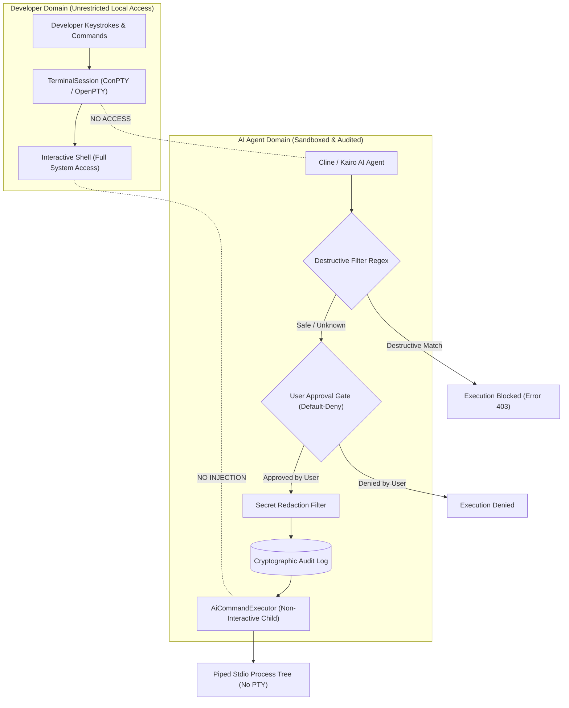

# Kairo IDE – Terminal Security Architecture

## 1. Security Overview

The Kairo IDE terminal subsystem enforces a strict architectural boundary between **Interactive Developer PTY Sessions** and **AI Coding Agent Execution**. An AI agent can never type into, spoof input, or siphon data from an interactive developer terminal.

All non-interactive AI command operations are routed through a sandboxed pipeline (`AiCommandExecutor` and `AiTerminalExecutionAdapter`) governed by:
- **Default-Deny Approval Policies**: Explicit user authorization is required for command execution unless explicitly marked as a safe, read-only pattern.
- **Destructive Command Defense**: Proactive blocking of system-damaging commands (`rm -rf /`, `del /s C:\`, `format`, `dd if=`).
- **Secret Redaction**: Automatic masking of sensitive access tokens, API keys, and credentials from outputs and audit logs.
- **Strict Resource Bounds**: Hard 1 MB stdout/stderr buffer limits and configurable execution timeouts to eliminate denial-of-service risks.

---

## 2. Interactive PTY vs AI Execution Boundary

### Key Isolation Guarantees:
1. **No Shared File Descriptors**: The AI executor uses standard OS piped child processes (`std::process::Command` with `Stdio::piped()`). It never obtains handles or references to the developer's interactive slave PTYs.
2. **No Terminal State Poisoning**: Commands run by an AI agent cannot alter environment variables, current working directories, or shell history of open user terminal tabs.
3. **No Unaudited Execution**: Every AI invocation generates a SHA-256 hashed audit record recording timestamp, command string, target working directory, approval decision, execution time, and exit status.

---

## 3. Destructive Command Filtering

The `AiTerminalExecutionAdapter` evaluates incoming command strings against known catastrophic command patterns before prompting the user:

### 3.1 Blocked Patterns
- **Root/Drive Deletion**: `rm\s+(-[a-zA-Z]*r[a-zA-Z]*f*|-rf)\s+[/~]`, `del\s+/[sS]\s+[cC]:\\`
- **Volume Formatting & Partitioning**: `format\s+[a-zA-Z]:`, `mkfs`, `fdisk`, `diskpart`
- **Raw Disk Writing**: `dd\s+if=.*of=/dev/(sd|hd|nvme|disk)`
- **Remote Code Piped Directly to Shell**: `curl\s+.*\|\s*(bash|sh|zsh|powershell|pwsh)`, `wget\s+.*\|\s*(bash|sh)`
- **Fork Bombs & Resource Exhaustion**: `:\(\)\s*\{\s*:\|:&\s*\};:`, `for\s*/l\s*%i`

When a command matches a destructive pattern:
1. Execution is instantly aborted with an audit status of `blocked_destructive`.
2. The user is notified with a high-priority security alert.
3. The command is never sent to the Rust backend.

---

## 4. Secret & Credential Redaction

Both live command output and audit trails pass through an automated credential redaction engine. The engine matches and masks known API key and secret patterns:

| Secret Type | Pattern Matched | Redacted Output |
| :--- | :--- | :--- |
| **GitHub Personal Access Token** | `ghp_[a-zA-Z0-9]{36}` | `[REDACTED_GH_TOKEN]` |
| **GitHub Fine-Grained Token** | `github_pat_[a-zA-Z0-9_]{82}` | `[REDACTED_GH_TOKEN]` |
| **AWS Access Key ID** | `AKIA[0-9A-Z]{16}` | `[REDACTED_AWS_KEY]` |
| **OpenAI API Key** | `sk-[a-zA-Z0-9]{48}` | `[REDACTED_API_KEY]` |
| **Anthropic API Key** | `sk-ant-[a-zA-Z0-9_-]{80,}` | `[REDACTED_API_KEY]` |
| **Password Arguments** | `(--password\|-p\s+)\S+` | `--password=[REDACTED]` |

---

## 5. Resource Bounds & Denial-of-Service Defense

### 5.1 Output Byte Bounds
Commands generating infinite output (e.g. `cat /dev/urandom` or an infinite loop printing lines) can exhaust IDE memory if unbounded.
- **Default Limit**: `1,048,576 bytes` (1 MB) per execution stream.
- **Enforcement**: Piped stdout/stderr threads track accumulated bytes. Once the limit is reached, reading halts, the output is flagged with `truncated: true`, and the child process is terminated.

### 5.2 Execution Timeouts
- **Default Timeout**: `30,000 ms` (30 seconds) for synchronous commands.
- **Enforcement**: If a command does not exit within the timeout window, the Rust backend invokes `kill_process_by_pid` on the entire process tree and returns a timed-out exit status (`-1`).

### 5.3 Process Tree Teardown (`stop_all`)
Child processes spawned by shell scripts or build tools can easily become orphaned.
- **Windows**: `taskkill /pid <PID> /T /F` forcefully terminates the root process and all child processes created by it.
- **Unix**: Process group signaling (`kill -TERM -<PID>` followed by `kill -9 -<PID>`) guarantees complete tree termination.
- **Application Shutdown**: When Kairo IDE closes (`WindowEvent::Destroyed`), `terminal_state.kill_all()` and `ai_state.stop_all()` are executed simultaneously.

---

## 6. Remaining Security Considerations & Boundaries

While the terminal subsystem provides robust isolation:
1. **User Privilege Level**: The terminal runs with the operating system privileges of the local desktop user. It does not run in a hypervisor VM or root container.
2. **Host Shell Configuration**: User environment dotfiles (`.bashrc`, `.zshrc`, PowerShell `$PROFILE`) are executed by default when opening user shells.
3. **Workspace Path Containment**: AI commands default to executing within the active workspace root. If a command attempts to specify an absolute directory outside the workspace root, approval gates explicitly highlight the out-of-bounds working directory.
