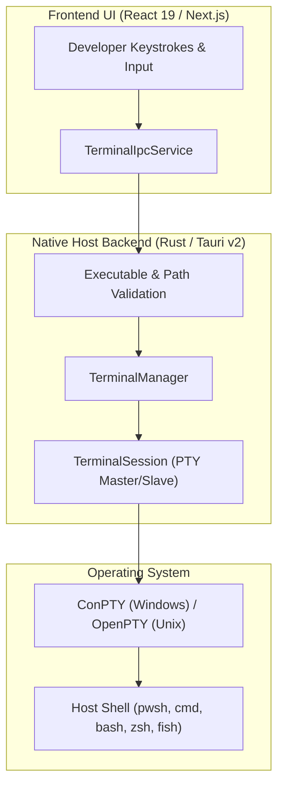

# Kairo IDE – Terminal Security Model

## 1. Security Overview

The Kairo IDE terminal subsystem executes interactive developer PTY sessions with native local system integration.

### Core Architectural Principles:
- **Interactive Developer PTY Sessions**: Direct user-driven terminal sessions spawned via `portable-pty` (ConPTY on Windows, OpenPTY on Unix/macOS/Linux).
- **Executable Path & Name Validation**: All shell requests validate the executable against system paths and known binaries before spawning.
- **Working Directory Verification**: Working directories are validated for existence before session initialization, falling back safely to the active workspace root.
- **Process Lifecycle & Tree Teardown**: Two-stage termination (graceful SIGINT followed by OS process tree kill) ensures no orphan background processes are left running on window or session closure.

---

## 2. Interactive PTY Execution Architecture

---

## 3. Path & Executable Safety

### 3.1 Shell Executable Validation
Before spawning any terminal session, the backend performs validation:
1. Standard shells (PowerShell, CMD, Git Bash, Bash, Zsh, Fish) are detected via deterministic filesystem and registry paths.
2. Custom profile executables must exist on the local filesystem or resolve to a valid executable via system `PATH`.
3. Non-existent shell paths return `TerminalError::ShellNotFound`.

### 3.2 Working Directory Resolution
1. Target directory must be an existing directory on the filesystem (`Path::is_dir()`).
2. If invalid or unreadable, the subsystem rejects initialization with `TerminalError::InvalidWorkingDirectory` rather than launching in an unexpected location.

---

## 4. Lifecycle & Clean Teardown

To prevent orphaned processes:
- **Individual Session Kill (`terminal_kill`)**: Attempts graceful interrupt before terminating the child process tree.
- **Application Teardown**: On `WindowEvent::Destroyed`, `terminal_state.kill_all()` is executed to cleanly shut down all active PTY sessions.
